- **URL:** https://prosparity.in/
- **HTTP status on direct load:** 200
- **Title:** Home | ProsParity
- **Meta description:** Reimagining Distribution Of Credit In The Electric Mobility Sector
- **Meta title:** Reimagining Distribution Of Credit In The Electric Mobility Sector
- **Canonical:** https://prosparity.in/
- **og:title:** Reimagining Distribution Of Credit In The Electric Mobility Sector
- **og:url:** https://prosparity.in
- **Robots:** index,follow
- **Screenshot:** ../screenshots/home.png
- **Capture note:** the team section shows both tabs and all bio modals, which appear only after clicking.
- **Text fidelity:** wording and letter case come from the DOM text nodes, not the on-screen rendering, so CSS uppercase or capitalise is not applied here.

---

<!-- site header start -->

[Our products](/#products)

[Why us](/#why-us)

[About us](/#teams)

[Our Investors](/#investors)

[Contact us](/#contact)

<!-- site header end -->

<!-- main content start -->

<!-- visual heading: 
 at 32px, not a semantic heading on the site -->
# Reimagining Distribution Of Credit In The Electric Mobility Sector

We are building a full-stack digital financing platform to enable seamless flow of credit from lenders to individuals, fleet operators, dealers, and OEMs, driving widespread adoption of electric vehicles across Bharat for a sustainable future

[Contact us](#contact)

## Our Products

<!-- CSS background image: ../assets/three-wheeler.png -->

<!-- visual heading:  at 32px, not a semantic heading on the site -->
### Electric 3 Wheeler

Get loans for efficient and eco-friendly  
options for last-mile transportation  
needs

<!-- CSS background image: ../assets/two-wheeler.png -->

<!-- visual heading:  at 32px, not a semantic heading on the site -->
### Electric 2 Wheeler

Avail loans for reliable  
and convenient electric  
two wheelers for urban  
and rural commuting

<!-- CSS background image: ../assets/dealerships.png -->

<!-- visual heading:  at 32px, not a semantic heading on the site -->
### Dealer Financing

With competitive rates and selective assessment criteria, we empower dealers to grow their businesses while fostering strong, mutually beneficial relationships

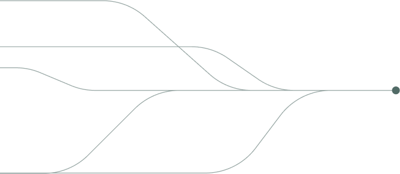

<!-- visual heading:  at 48px, not a semantic heading on the site -->
## Why ProsParity

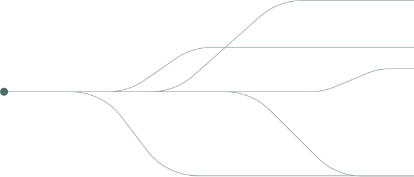

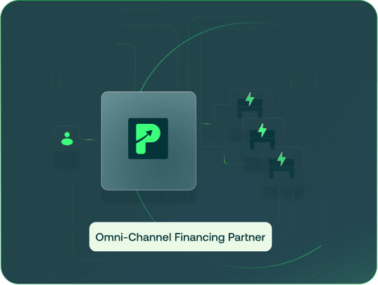

<!-- visual heading:  at 32px, not a semantic heading on the site -->
### OEMs

Omni-channel financing partner for electric products across wide geographies

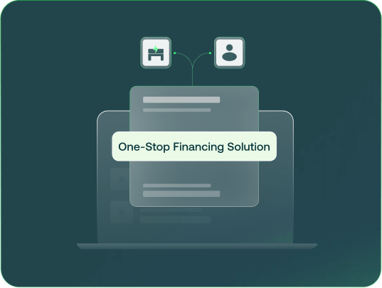

<!-- visual heading:  at 32px, not a semantic heading on the site -->
### Dealers

One-stop, quick and convenient financing solution for your business requirements

<!-- visual heading:  at 32px, not a semantic heading on the site -->
### Lenders

Build a high-quality secured portfolio in an impact oriented new asset class (electric mobility) through our full-service platform

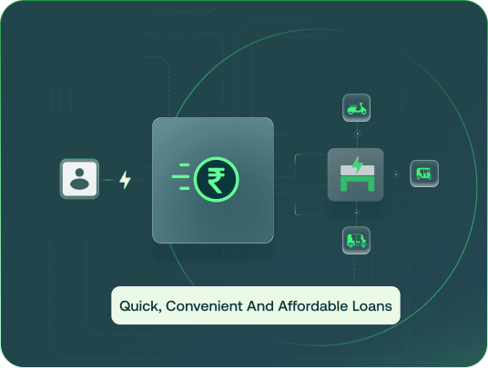

<!-- visual heading:  at 32px, not a semantic heading on the site -->
### Customers

Quick, convenient and affordable loans for purchasing next-generation electric vehicles

<!-- CSS background image: ../assets/mesh-bg.png -->

<!-- visual heading:  at 32px, not a semantic heading on the site -->
### Empowering sustainable mobility by doing our bit

At ProsParity, sustainability is our guiding principle. We champion inclusive economic growth through initiatives such as supporting EVs for livelihood generation, recognizing the immense potential for impact in India's growing EV market.

By bridging transportation gaps, reducing pollution, and improving the lives of drivers, we're driving meaningful change.

Join us on our sustainable journey, where every mile counts towards building a greener, more equitable future.

<!-- team section: the card and bio text below comes from clicking each tab and each card's button -->

### Founding Team

<!-- tab button: "Founding Team" -->

#### Saurabh Khodke

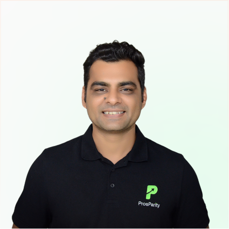

Co-Founder and CEO

Saurabh boasts over 12 years of expertise in origination, credit, and debt capital markets. During his tenure at Northern Arc Capital, he was instrumental in establishing the consumer lending asset class and leading the vehicle finance asset class. At ProsParity, Saurabh leads fundraising, finance, strategy, risk management, and overall organizational development, skillfully blending technology, consumer credit, and asset financing. He holds an MBA from IIFM-Bhopal.

LinkedIn: https://www.linkedin.com/in/saurabh-khodke-80694240/?originalSubdomain=in

#### Anirudh Dhakar

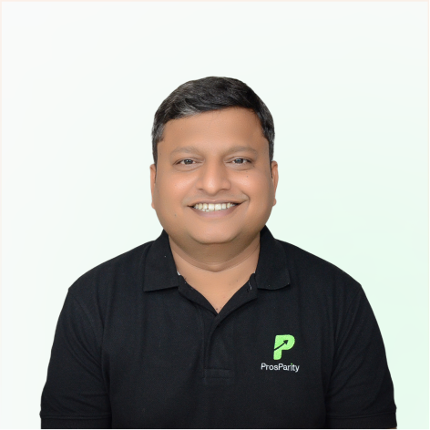

Co-Founder and COO

Anirudh brings over a decade of experience to the table, having worked with SBI, Northern Arc Capital, and more. His expertise lies in crafting and scaling lending platforms harmonizing multiple stakeholders seamlessly, and maintaining high standards in processes, credit quality, and compliance. Known for his successful collaborations with various fintech lending firms, he excels in driving sales, credit, technology, and product strategies with finesse. Anirudh is focused on leading ProsParity towards becoming a top-tier lending platform in asset financing. Anirudh holds an MBA from IIFM-Bhopal.

LinkedIn: https://www.linkedin.com/in/anirudh-dhakar-78979a4b/

#### Hakam Singh Dhakar

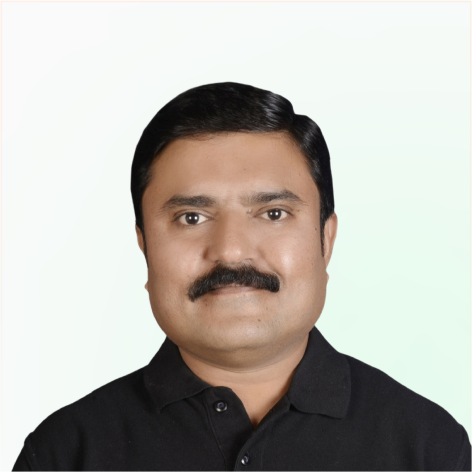

Co-Founder and Business Head

Hakam brings over 23 years of experience in sales, credit, and managerial roles across various financial institutions such as Mahindra, Sonalika, L&T Finance and Sundaram Finance. He was instrumental in setting up the Tractor & Agri-equipment financing vertical for Sundaram Finance in Chhattisgarh. At ProsParity, Hakam heads the 3-wheeler segment, managing the field team end-to-end from sourcing and underwriting to collections.

LinkedIn: https://www.linkedin.com/in/hakam-singh-dhakar-935bb9317/

#### Jitendra Sharma 

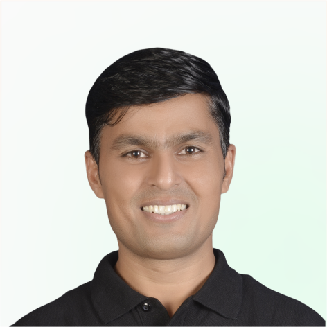

Co-Founder and Business Head

Jitendra brings over 18 years of experience from the credit & lending space where he oversaw sales and collections of various assets such as tractors, cars, SUVs, and LCVs during his time at firms such as Sundaram Finance, HDFC and Kotak Mahindra. He was instrumental in growing Sundaram Finance’s footprint in the commercial vehicle financing space in Madhya Pradesh from its early days. At ProsParity, Jitendra heads the 2-wheeler segment, managing the field team end-to-end from sourcing and underwriting to collections.

LinkedIn: https://www.linkedin.com/in/jitendra-sharma-256008318/

#### Kanishk Agarwal

Founding Member

Kanishk brings over 5 years of extensive experience in the financial services and consulting industry, having contributed significantly at TresVista Analytics, Stashfin, and Alstonia Impact. Throughout his career, he has worked closely with founders on key topics such as Investor Relations, Fund Raising, and M&A opportunities. As the first employee and a founding member of ProsParity, Kanishk plays a pivotal role in driving the company’s 0 to 1 journey, focusing on product development, strategic planning, fundraising, and operational execution.

LinkedIn: https://www.linkedin.com/in/kanishk-agarwal?utm_source=share&utm_campaign=share_via&utm_content=profile&utm_medium=android_app

### Team

<!-- tab button: "Team" -->

#### Sunil Dubey

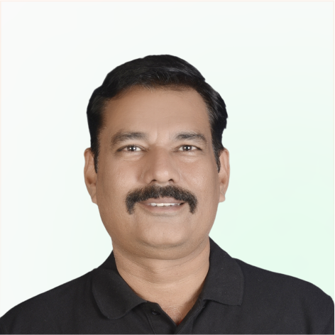

State Head

Sunil brings over 20 years of experience in sales, business development, and managerial roles across various financial institutions such as Mahindra, Sundaram Finance, Chola and Hinduja Leyland Finance. Over the course of his career, he worked on various initiatives such as team building & management, business development, collections & recovery, etc. At ProsParity, Sunil is an area head and looks at business development.

LinkedIn: https://www.linkedin.com/in/sunil-dubey-aa121931a/

#### Rahul Pandey

Lead, Credit Ops

Rahul is a core team member of ProsParity. He brings deep expertise in credit and business operations, with a strong background in fintech and lending. Prior to joining ProsParity, he played a key role in co-lending operations at Stashfin, ensuring efficient execution and seamless partnerships. Before that, at BharatPe, he contributed to building and scaling lending finance, optimizing processes, and driving operational excellence.  As part of the Credit Ops team at ProsParity, Rahul is instrumental in driving the company's zero-to-one journey. He focuses on building and streamlining credit and business operations, ensuring compliance, efficiency, and innovation to create a scalable and robust financial ecosystem.

LinkedIn: https://www.linkedin.com/in/rahul-pandey-871013194/

<!-- visual heading: 
 at 48px, not a semantic heading on the site -->
## Our Investors

[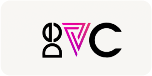](https://www.devc.com/)

<!-- CSS background image: ../assets/contact-us.png -->

<!-- visual heading:  at 52px, not a semantic heading on the site -->
## Join us in the EV Revolution!

<!-- visual heading:  at 24px, not a semantic heading on the site -->
### Contact Info

[hello@prosparity.in](mailto:hello@prosparity.in)

[input type=text name=firstName placeholder="Enter first name"]

[input type=text name=lastName placeholder="Enter last name"]

[input type=email name=email placeholder="Please enter your email address"]

[input type=number name=phone placeholder="Please enter your phone number"]

[textarea name=message placeholder="Hey. say something"]

[button: Contact us]

<!-- main content end -->

<!-- site footer start -->

[Our products](/#products)

[Why us](/#why-us)

[About us](/#teams)

[Our Investors](/#investors)

Copyright © 2024 Etribe Finance Private Limited

[Privacy Policy](/privacy-policy)

[Terms & Conditions](/terms-and-conditions)

[DLG Disclosure](/dlg-disclosure)

[Refund and Cancellation Policy](/refund-and-cancellation-policy)

[Grievance Redressal & Disclosures](/grievance-redressal-and-disclosures)

<!-- site footer end -->

---

## Appendix: text in the DOM but not visible at 1440 px

- (display:none, <button>) click to toggle the mobile navigation modal
- (off-canvas drawer, 
) Our productsWhy usAbout usOur Investors
- (display:none, 
) OEMs Omni-channel financing partner for electric products across wide geographies Dealers One-stop, quick and convenient financing solution for your business requirements Lenders Build a high-quality secured portfolio in an impact oriented new asset class (electric mobility) through our full-service platform Customers Quick, convenient and affordable loans for purchasing next-generation electric vehicles
- (display:none, 
) Copyright © 2024 Etribe Finance Private Limited
